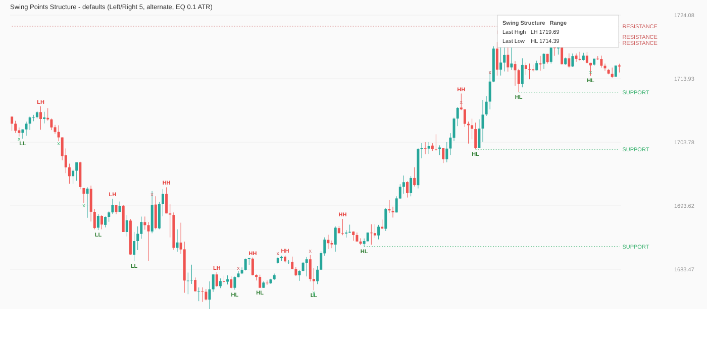
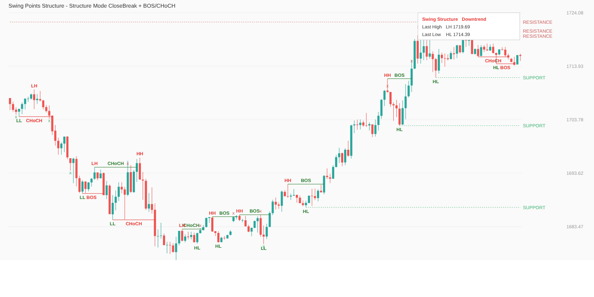

# Swing Points Structure (cTrader-Indikator)

Nachbau der Funktion von „Swing Points by MATA“ (TradingView) für cTrader, plus ICT-Erweiterungen.
Eine Datei: `SwingPointsStructure.cs` (in cTrader: Automate → Indicators → New → Inhalt ersetzen → Build).

## Was er zeigt

| Element | Logik |
|---|---|
| **Swing-Punkte** | Fraktal-Pivot: Hoch höher als die `Left Bars` davor und nicht übertroffen von den `Right Bars` danach (Tief analog). Erst bestätigt, wenn die `Right Bars` **geschlossen** sind, also immer mit `Right Bars` Kerzen Verzögerung |
| **HH / LH / EQH, HL / LL / EQL** | Vergleich mit dem vorigen Swing derselben Seite; innerhalb `Equal Tolerance × ATR` = gleiches Hoch/Tief (EQH/EQL = Liquiditätspool) |
| **Alternierung** | `Alternate Highs/Lows`: auf ein Hoch folgt immer ein Tief. Zwei Hochs in Folge → das höhere gewinnt, das alte Label **verschwindet** (2021 bei M15-Gold: 14 % der Swings) |
| **Swing Structure** | `SwingLabels` (wie MATA): Uptrend = letztes Hoch HH **und** letztes Tief HL; Downtrend = LH und LL; sonst Range. `CloseBreak` (ICT): Trend wechselt, wenn eine Kerze **über das letzte Swing-Hoch / unter das letzte Swing-Tief schließt**; optional als BOS (mit Trend) / CHoCH (Wechsel) eingezeichnet |
| **RESISTANCE / SUPPORT** | gepunktete Linien der jüngsten `S/R Levels per Side` noch ungebrochenen Swing-Levels bis zur aktuellen Kerze. Ein Schlusskurs jenseits des Levels beendet die Linie (optional bleibt sie verblasst stehen) |
| **Sweep (x)** | Docht durch ein Level, Schluss wieder davor = Liquidität abgeholt (einmal je Level) |
| **Tabelle** | oben rechts: Struktur, letztes Hoch, letztes Tief (Farbe nach Trend) |
| **Outputs** | `Swing High`, `Swing Low` (Wert am Pivot-Bar) für die Nutzung aus einem cBot |

Alle Swing-Regeln stecken in der Klasse `SwingEngine` ohne cTrader-Typen. Sie wird offline getestet (`test/`).

## Tests (echte XAUUSD-M15-Kerzen 2021, 23 581 Kerzen)

- Ohne Alternierung findet die Engine **exakt** dieselben 2 876 Pivots wie eine Brute-Force-Referenz.
- Label-Regel, Alternierung, „aktive Level wurden nie durchschlossen“: 0 Verstöße in allen Modi.
- Chart-Objekte sind begrenzt (`Max Labels` je Objektart). Ohne Begrenzung waren es nach einem Jahr über 1 400 Objekte.
- Aufruf: `cd test && dotnet build -c Release -o out && out/SwingTest --m15 XAUUSDm15.csv [--set Name=Wert] [--dump x.csv]`,
  Vorschau mit `python3 render_svg.py x.csv x.svg`.

Grenzen der Tests: Der Test kompiliert gegen eine nachgebaute cAlgo-API. Zeichenfunktionen und Parameter-Typen
(z. B. `Color`-Parameter, ab cTrader 4.x) sind nach der echten API benannt, aber erst der Build in cTrader beweist es.
