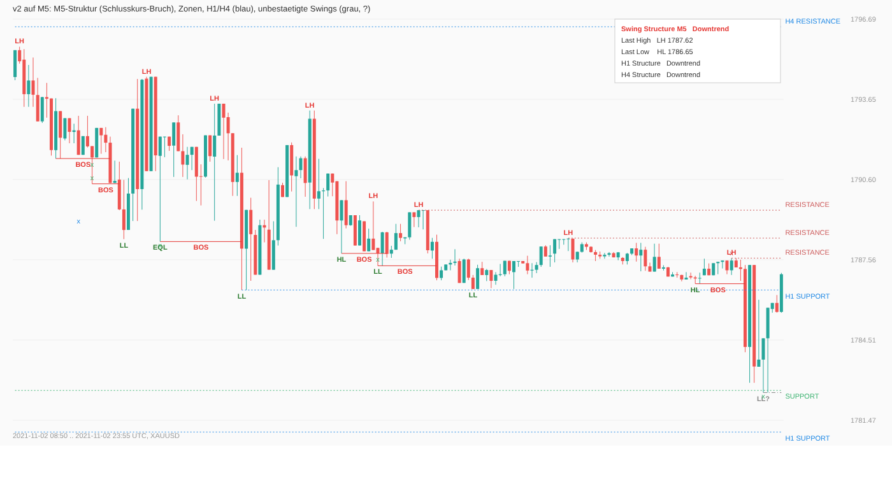
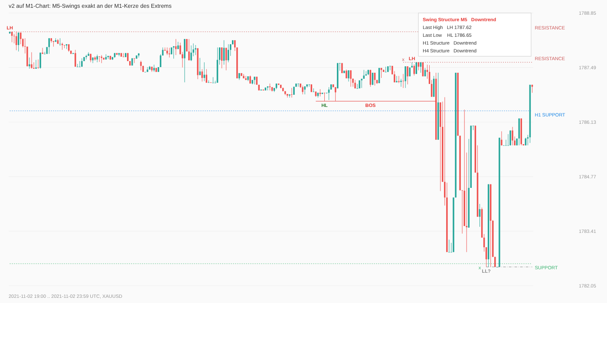
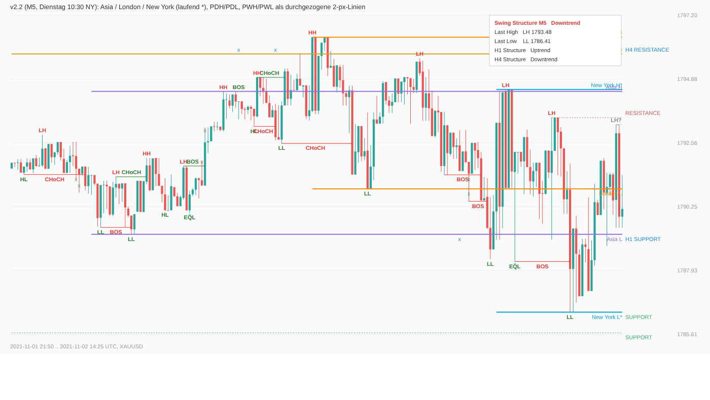

# Swing Points Structure v2.2 (cTrader-Indikator)

Nachbau von „Swing Points by MATA“ (TradingView) für cTrader, ausgebaut für manuelles Gold-Trading auf M1–M5 nach ICT.
Eine Datei: `SwingPointsStructure.cs`.

## Installation (cTrader Desktop für Mac)

1. cTrader öffnen → **Algo** → **Indicators** → **+ New** → Namen vergeben (z. B. `SwingPointsStructure`).
2. Den gesamten Inhalt von `SwingPointsStructure.cs` hineinkopieren (den Vorlagen-Code ersetzen) → **Build**.
3. Im Chart (XAUUSD, M1/M2/M3/M5) über **Indicators** → **Custom** → `SwingPointsStructure` hinzufügen.
4. Oben links erscheint die **Statuszeile**, z. B. `Swing Points Structure v2.2 | M5 12000 Kerzen, 1100 Swings | H1* ... | H4* ...`.
   Steht dort `FEHLER ...`, bitte den Text schicken (er steht auch im Log: Algo → Indikator → Log).
   Erscheint gar keine Statuszeile, ist der Indikator nicht auf dem Chart aktiv.

Die cTrader-Handy-App kann **keine eigenen Indikatoren** anzeigen, nur die eingebauten. Der Indikator läuft also nur,
solange cTrader auf dem Mac geöffnet ist. Die Alarme kommen trotzdem aufs Handy (Telegram oder E-Mail, siehe unten).

## Was er zeigt

| Element | Logik |
|---|---|
| **M5-Struktur auf jedem Chart** | `Structure Timeframe` (Standard M5) wird auch auf M1/M2/M3 gezeichnet; das Label steht genau an der M1-Kerze, die das Extrem gemacht hat |
| **Swing-Punkte** | Fraktal-Pivot: Hoch höher als die 5 Kerzen davor und nicht übertroffen von den 5 Kerzen danach (Tief analog). Bestätigt, wenn die 5 Kerzen **geschlossen** sind (auf M5: 25 Minuten), danach nie verschoben |
| **HH / LH / EQH, HL / LL / EQL** | Vergleich mit dem vorigen Swing derselben Seite; innerhalb 0,1 × ATR = gleiches Hoch/Tief |
| **Unbestätigte Swings (grau, „?“)** | möglicher Swing, dessen Bestätigungskerzen noch fehlen. Kann wieder verschwinden |
| **Struktur (Tabelle + BOS / CHoCH)** | Standard `CloseBreak` (ICT): Der Trend wechselt erst, wenn eine Kerze **über das letzte Swing-Hoch bzw. unter das letzte Swing-Tief schließt**. Bruch mit dem Trend = BOS, gegen den Trend = CHoCH. Alternativ `SwingLabels` (wie MATA: HH + HL = Uptrend) |
| **Liquiditätszonen** | ungebrochene Swing-Levels als gepunktete Linie. Liegen mehrere Hochs/Tiefe innerhalb 0,25 × ATR beieinander, werden sie zu **einer Zone** („RESISTANCE ZONE (3x)“): Equal Highs/Lows = Liquiditätspool. Ein Schlusskurs jenseits der äußeren Kante beendet die Zone |
| **Sweep (x)** | Docht durch die Zone, Schlusskurs zurück = Liquidität abgeholt |
| **H1 / H4 (blau, je abschaltbar)** | eigene Zonen und Strukturzeile in der Tabelle; optional Labels. Liegt eine H1-Zone auf einer H4-Zone, wird nur die H4-Zone gezeichnet |
| **Key Levels (v2.2, je abschaltbar)** | durchgezogene Linien, 1 px dicker als die Strukturlinien (`Key Level Thickness` = 2): Hoch/Tief der jeweils letzten **Asia-, London- und New-York-Session** (laufende Session mit `*`, aktualisiert sich live) sowie **PDH/PDL** und **PWH/PWL** aus der Tages- bzw. Wochenkerze des Brokers. Jede Linie beginnt am Start ihrer Session/Kerze und läuft bis zur aktuellen Kerze |
| **Alarme** | CHoCH, BOS, Sweep, je abschaltbar; Popup am Mac, E-Mail, Telegram-Push. Nur für Kerzen, die schließen, während der Chart läuft (nie für die Historie), nur im Zeitfenster `Alert From/To Hour (UTC)` |

## Handy-Push einrichten

cTrader hat keine Funktion, mit der ein Indikator eine Push-Nachricht an die cTrader-App schickt (nur Popup, Ton und E-Mail).
Zwei Wege aufs Handy, beide abschaltbar:

- **Telegram (empfohlen, echter Push):** In Telegram `@BotFather` → `/newbot` → Token kopieren. Dem neuen Bot einmal „Hallo“ schreiben,
  dann `https://api.telegram.org/bot<TOKEN>/getUpdates` im Browser öffnen und die `chat":{"id":…` ablesen.
  Im Indikator `Telegram Push = Yes`, Token und Chat-Id eintragen.
- **E-Mail über cTrader:** cTrader → Einstellungen → Advanced → Email: SMTP-Daten eintragen und „Enable email“ aktivieren.
  Im Indikator `E-Mail = Yes`, Absender und Empfänger eintragen. Die Mail-App am Handy meldet die Mail.

Gemessen (3 Wochen M1-Chart mit M5-Struktur, Standardwerte, 06–20 UTC): **etwa 8 Alarme pro Tag**,
davon etwa 5 M5-CHoCH und 3–4 Sweeps von Pools bzw. H1/H4-Zonen. Ohne `Alert on CHoCH` sind es etwa 3–4 pro Tag.
Sweep-Alarme gibt es auf M5 nur für Pools mit mindestens 2 gleichen Swings (`Sweep Alert Min Equal Swings`), sonst wären es über 20 pro Tag.

## Wichtige Parameter

| Gruppe | Parameter | Standard |
|---|---|---|
| 1 Structure | `Structure Timeframe`, `Left Bars`, `Right Bars` | M5, 5, 5 |
| 1 | `Structure Mode` | CloseBreak |
| 1 | `Alternate Highs/Lows` | Ja (zwei Hochs in Folge → nur das höhere bleibt, das alte Label verschwindet: ~14 % der Swings) |
| 1 | `Show Pending Swings`, `Show BOS / CHoCH` | Ja, Ja |
| 2 Liquidity Zones | `Zones per Side`, `Zone Tolerance (ATR)`, `Mark Liquidity Sweeps`, `Keep Broken Zones` | 3, 0,25, Ja, Nein |
| 3 Higher Timeframes | `Show H1 Structure`, `Show H4 Structure`, `HTF Left/Right Bars`, `HTF Zones per Side`, `Show HTF Labels` | Ja, Ja, 3, 2, Nein |
| 4 Alerts | `Alerts`, `Alert on CHoCH / BOS / Sweep`, `Alert on H1/H4 Events` | Ja; Ja / Nein / Ja; Ja |
| 4 | `Sweep Alert Min Equal Swings`, `Alert From/To Hour (UTC)` | 2, 6–20 |
| 4 | `Popup`, `E-Mail` (+ From/To), `Telegram Push` (+ Token/Chat Id) | Ja, Nein, Nein |
| 7 Key Levels | `Show Asia High/Low`, `Asia Start/End (NY hour)` | Ja, 20:00–00:00 New York (ICT Asian Range) |
| 7 | `Show London High/Low`, `London Start/End (NY hour)` | Ja, 02:00–05:00 New York (London Killzone) |
| 7 | `Show New York High/Low`, `New York Start/End (NY hour)` | Ja, 07:00–11:00 New York (NY AM) |
| 7 | `Show Previous Day High/Low`, `Show Previous Week High/Low` | Ja, Ja |
| 7 | `Key Level Thickness`, Farben je Level | 2; Asia lila, London orange, New York hellblau, Vortag gold, Vorwoche orchidee |

Session-Zeiten sind in **New-York-Zeit** eingestellt; Sommer-/Winterzeit wird automatisch berücksichtigt (für Deutschland:
Asia 02:00–06:00, London 08:00–11:00, New York 13:00–17:00 MEZ/MESZ, außer in den 2–3 Wochen, in denen die USA und Europa
unterschiedlich umstellen). Wer die klassischen ganzen Sessions möchte: z. B. London 03:00–11:30, New York 08:00–17:00 eintragen.
Vortag/Vorwoche kommen aus den D1-/W1-Kerzen deines Brokers. Bei Brokern mit Tageswechsel 00:00 UTC wird die kurze
Sonntagskerze übersprungen (Montag zeigt den Freitag); bei New-York-Schluss-Brokern (z. B. Pepperstone) gehört der Sonntagabend zum Montag.

## Tests

Offline gegen eine Nachbildung der cAlgo-API (`test/`), mit echten XAUUSD-M15-Kerzen 2021 und M1-Daten (M15 echt, Feinstruktur synthetisch):

- Swing-Erkennung = Brute-Force-Referenz (2 876 Pivots identisch); Labels, Alternierung, aktive Zonen nie durchschlossen: 0 Verstöße.
- **Kein Vorgriff:** Keine Ebene (M5, H1, H4) verarbeitet je eine Kerze, die noch nicht geschlossen ist.
- **M5-Struktur auf dem M1-Chart = eigenständige Berechnung auf M5-Kerzen** (identische Swings, Labels und Trend).
- Alarme nur aus dem Live-Teil, Chart-Objekte begrenzt (`Max Objects per Kind`).
- v2.2: Session-, Vortages- und Vorwochen-Level werden unabhängig aus den Basiskerzen nachgerechnet und mit den gezeichneten
  Linien verglichen, an 6 Zeitpunkten einer Woche (Sonntagabend, Montagmorgen, laufende NY-Session …) und für beide Broker-
  Tageswechsel (17:00 New York und 00:00 UTC). Dabei gefunden und behoben: Am Montag/Dienstag wurde bei New-York-Schluss-Brokern
  der falsche Vortag genommen.
- v2.1: zusätzlich ein Testmodus wie in cTrader (gesamte Historie vor dem Start geladen); eigene Zeit→Kerzen-Suche statt
  `GetIndexByTime` (liefert in cTrader die *nächstgelegene* Kerze, auch eine spätere); Zeitrahmenlänge aus den Kerzen statt
  aus `TimeFrame`-Vergleichen; jede Ausnahme wird oben links und im Log angezeigt statt den Chart leer zu lassen.
- Aufruf: `cd test && dotnet build -c Release -o out && out/SwingTest --m15 XAUUSDm15.csv` bzw.
  `out/SwingTest --m1 xau_m1.csv --chart Minute --structure Minute5`; Vorschau: `--dump x.csv` und `python3 render_svg.py x.csv x.svg`.

Grenze: Kompiliert ist gegen eine nachgebaute API mit den Namen der echten cTrader-API (`Color`- und `TimeFrame`-Parameter,
`Chart.DrawRectangle`, `Notifications.ShowPopup`, `Http.Get`). Erst der Build in cTrader beweist, dass alles passt.
`Http.Get` (Telegram) funktioniert laut cTrader-Dokumentation ohne Zusatzrechte. Ein Forenbericht meldet für cTrader 5.2.5,
dass nur die erste Nachricht ankam; falls das bei dir auftritt, bitte melden.
